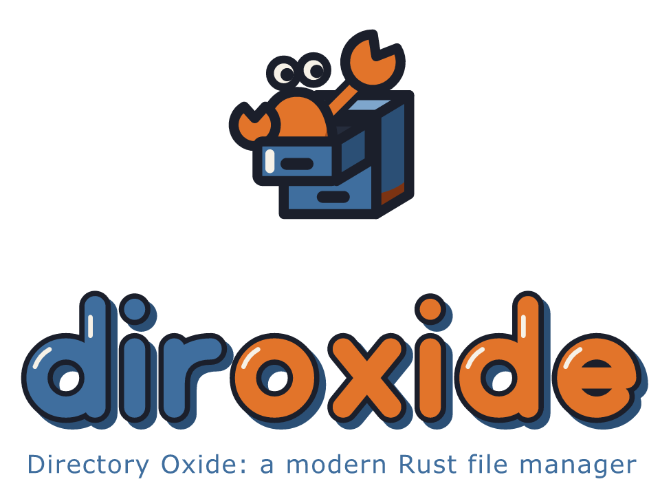

# diroxide

<picture>
  <source media="(prefers-color-scheme: dark)" srcset="assets/logo/png/diroxide-lockup-dark-960.png">
  
</picture>

diroxide (Directory Oxide) is a two-panel file manager written in pure Rust, in the orthodox style of Worker and Directory Opus. Its command is `diro`. It is designed first for people who use a screen reader or a Braille display, and for anyone who works from the keyboard. Every row says what it is in its first 40 characters, status is always words, color never carries meaning alone, and every delete lists what it will remove and starts on No. It is written for Windows, Linux and macOS, with no X11 code.

Status: alpha. This is alpha 1, version 0.1.0-alpha.1: a terminal file manager for local folders and archives. It has copy, move, rename, trash and undo; archives opened like folders; a viewer and a quick view; split and join; links and permissions; search with a filter language; labels and bookmarks; file compare; a list of keys you can change, with key presets; watching a folder; and command-line subcommands. The window comes in a later alpha. [Known limits](docs/known-limits.md) lists what it does not do yet, and the [accessibility statement](docs/accessibility.md) says what has been checked by ear and what has not.

## Get diro

There are two ways in: one file for each platform, and `cargo install diro`. Alpha 1 has the files; the crate comes with the first beta.

- Download the one file for your platform from the [releases page](https://github.com/leavesofgrass/diroxide/releases): `diro.exe` for Windows, one `diro` for macOS (Apple silicon and Intel in one file), and an AppImage for Linux. There is no archive to open and no installer. The builds are not code-signed, so each platform needs one first-run step. On Windows, SmartScreen warns first: choose More info, then Run anyway. On macOS, remove the quarantine mark once with `xattr -d com.apple.quarantine`, and make the file executable with `chmod +x`. On Linux, make the AppImage executable with `chmod +x`.
- Or build from source. You need a Rust toolchain from rustup (the repository pins the version and rustup fetches it) and the linker Rust needs on your system. Clone the repository, `https://github.com/leavesofgrass/diroxide`, and in its folder run:

```bash
cargo build --release -p diro
```

- The program is `target/release/diro`, or `diro.exe` on Windows. Put it on your PATH.
- `cargo install diro` comes with the first beta.

[Installing diroxide](docs/install.md) has every step.

## First steps

Run `diro` in a terminal. These keys are the same on every platform.

1. Tab switches between the two panels. diroxide says the panel and its folder.
2. The arrow keys move through the rows. Left goes to the parent folder, Right goes into the folder under the cursor, and Enter opens.
3. Space marks the row and moves down. A marked row says "selected".
4. F5 copies the marked rows, or the focused row, to the other panel. It asks first, and the answer starts on No.
5. F2 renames the focused entry.
6. Ctrl+P opens the command palette, a list of every command: type part of a name and press Enter. In the window, which comes in a later alpha, Ctrl+Shift+P does the same.
7. Ctrl+Q quits.

Ctrl+Z undoes the last job. Every delete, move and overwrite lists what it will touch before it asks.

## The terminal

In alpha 1 diroxide runs in the terminal; the window comes in a later alpha. Windows Terminal is the main target, and the classic console, Linux terminals and macOS Terminal are best effort. Terminals keep some keys for themselves, so the palette and the menus reach every command: see [Terminals](docs/terminals.md).

## Screen readers

diroxide has no voice of its own. It writes short lines that put their meaning first, and it keeps the cursor on the focused row, so NVDA, JAWS and a 40-cell Braille display can follow along; Orca and VoiceOver are best effort. [Using diroxide with a screen reader](docs/screen-readers.md) has the settings to check.

## Plugins

Plugins, in any language, come in a later alpha.

## Learn more

- [Quick start](docs/quickstart.md) and [installing diroxide](docs/install.md).
- [The panels](docs/panels.md), [operations and undo](docs/operations.md), [settings](docs/settings.md) and the [settings reference](docs/settings-reference.md).
- [Archives](docs/archives.md), [the viewer](docs/viewer.md), [the quick view](docs/quick-view.md), [split and join](docs/split-join.md) and [links, permissions and times](docs/links-permissions.md).
- [Search and the filter language](docs/search.md), [labels and bookmarks](docs/labels-bookmarks.md), [compare files](docs/compare.md) and [watching a folder](docs/watching.md).
- [Every key](docs/keyboard.md), generated from the keymap, and [customizing keys](docs/customizing-keys.md).
- [Terminals](docs/terminals.md) and [troubleshooting](docs/troubleshooting.md).
- [Known limits](docs/known-limits.md), [privacy](docs/privacy.md) and the [accessibility statement](docs/accessibility.md).
- [The documentation index](docs/README.md) and the [changelog](CHANGELOG.md).
- For people who build it: [the plan](docs/plan.md) and [building](docs/dev/building.md).

## Where it came from

diroxide reimplements the behavior of Worker, the orthodox two-panel manager, and borrows ideas from Directory Opus, Norton Commander, Midnight Commander and Total Commander. It was built clean room: Worker is GPL-2.0-or-later and diroxide is Apache-2.0 OR MIT, so Worker's behavior was described in specifications and its code was never copied. [The clean-room rule](docs/dev/clean-room.md) says how. Its accessibility rules and message style come from textweaver, a document reader by the same author.

## License

Copyright (c) 2026 Jon Pielaet

diroxide is licensed under either of

- the Apache License, Version 2.0 ([LICENSE-APACHE](LICENSE-APACHE)), or
- the MIT license ([LICENSE-MIT](LICENSE-MIT)),

at your option. See also [NOTICE](NOTICE).

Unless you explicitly state otherwise, any contribution intentionally submitted for inclusion in diroxide by you, as defined in the Apache-2.0 license, shall be dual licensed as above, without any additional terms or conditions.
